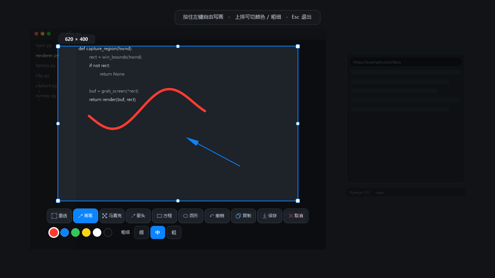
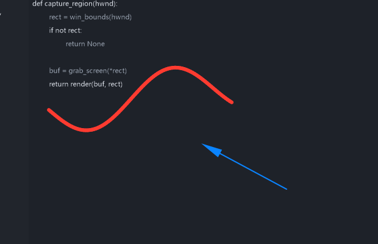

# SnapLite

轻量级 Windows 截图标注工具。**纯 Python + Win32 原生接口（GDI / GDI+）实现，零第三方依赖**——整个项目只有一个 `snap.py`，没有 numpy、没有 PyQt、没有 Pillow。


[](https://github.com/zhaozun123/Snaplite-screenshot/releases/latest)

---

## 下载

最新版本 **v1.3.0**（Windows 单文件绿色版，约 4.5 MB，64 位，双击即用，无需安装 Python）：

**[⬇ 下载 SnapLite.exe](https://github.com/zhaozun123/Snaplite-screenshot/releases/download/v1.3.0/SnapLite.exe)**

> 首次运行会在 `%APPDATA%\SnapLite\` 生成配置文件。托盘图标右键可退出（关窗口只是隐藏到托盘）。

**v1.3.0 更新**：

- **新增矩形 / 椭圆标注工具**：拖拽画出方框或圆圈，可拖 8 个手柄改大小、整体拖动、方向键微调
- **工具条重做排版**：图标与文字改为按真实墨迹整体居中，10 颗按钮左右留白差 ≤ 1px
- **工具条整体收窄**：外框缩至 0.86、字号只缩到 0.92，文字不显小但更紧凑
- **截图时把自身排除在外**：玻璃背景改为抓「没有自己」的真实桌面，不再靠插值猜，观感明显更实
- 内部重构：初始化与消息分派拆分、GDI+ 资源全部改为上下文管理、渲染缓存独立，为后续加文字标注打底

> **修复（同版本重打包）**：初版 v1.3.0 点「方框」「圆形」按钮没反应——按钮的点击派发
> 漏了这两种工具，会掉进兜底分支直接取消截图。现已修复，并补 `tests/test_tool_click.py`
> 逐按钮发真实窗口消息做回归，杜绝同类问题（新增工具时漏改派发分支）。

**v1.2.0**：界面改为苹果液态玻璃风；拖动主面板时背景模糊逐像素实时刷新；
修复截图时主界面不随遮罩一起压暗、点工具后主界面消失、工具条切换工具时选项排残留错乱等问题。

全部版本见 [Releases](https://github.com/zhaozun123/Snaplite-screenshot/releases)。

---

## 特性

| | |
|---|---|
| **全局热键唤起** | 默认 `Ctrl + Alt + A`，可在面板或托盘菜单里改成任意组合 |
| **智能区域识别** | 自动识别鼠标下的**窗口 / 控件**边界，单击直接捕获；也可以自由拖拽框选 |
| **8 个手柄微调** | 框选后可逐边、逐角调整范围，也能整体拖动 |
| **五种标注工具** | 画笔（自由手写）、马赛克（涂抹遮挡）、箭头（指向说明）、方框、圆形（圈重点） |
| **撤销 / 重做** | 多级撤销；箭头可拖两端改方向，方框/圆形可拖 8 手柄改大小，均可方向键微调 |
| **秒切输出** | 复制到剪贴板（CF_DIB）或另存为 PNG |
| **常驻托盘** | 关窗不退出，托盘菜单里可开/关开机自启 |
| **单文件绿色版** | 打包成一个 exe，扔哪都能跑，配置文件写在 `%APPDATA%\SnapLite\` |

## 界面



> 上图：全屏遮罩下框选区域，红色为画笔笔迹、蓝色为箭头，底部是浮动工具条。
> 导出成品（复制到剪贴板 / 保存 PNG 的结果）：



### 结构示意

```
┌──────────────────────────────────────────────────────┐
│  全屏半透明遮罩                                     │
│      ┌───────────────┐                               │
│      │  选区          │  ← 8 个手柄可调               │
│      │  ✎ 画笔笔迹    │                               │
│      └───────────────┘                               │
│                                                       │
│        ┌────────────────────────────────┐            │
│        │ 重选 │画笔│马赛克│箭头│撤销│复制│保存│取消 │  ← 浮动工具条
│        │  ●●●●●●  粗细 细│中│粗          │            │
│        └────────────────────────────────┘            │
└──────────────────────────────────────────────────────┘
```

## 使用

1. 运行 `SnapLite.exe`（或 `python snap.py`），程序常驻托盘
2. 按下 `Ctrl + Alt + A`（或自定义热键）唤起
3. **单击**鼠标下的窗口 / 控件 → 直接捕获；**拖拽** → 自由框选
4. 用工具条上的工具标注：
   - **画笔** — 按住左键自由手写，六种颜色 + 细/中/粗三档笔宽
   - **马赛克** — 涂抹遮挡，三档笔头 + 三档块大小
   - **箭头** — 拖动画箭头；画完可选中、拖两端改方向
   - **方框 / 圆形** — 拖两个对角画出；选中后拖 8 个手柄改大小，也能整体拖动
5. **复制**（进剪贴板）或 **保存**（存 PNG）

### 快捷键

| 键 | 作用 |
|---|---|
| `Ctrl + Alt + A` | 唤起截图（可自定义） |
| `Esc` | 取消当前操作 / 退出工具模式 |
| `Ctrl + Z` / `Ctrl + Y` | 撤销 / 重做 |
| `方向键` | 微调选中的标注（按住 `Shift` 一次 10px） |
| `Delete` | 删除选中的标注 |
| `右键` | 退出工具模式 / 删除最后一笔 |

> 在任意目录运行都可以，配置和日志统一落在 `%APPDATA%\SnapLite\`。

## 从源码运行

需要 **Windows 10/11 + Python 3.8 以上**（只用标准库，无需 `pip install` 任何东西）：

```bash
git clone https://github.com/zhaozun123/snaplite-screenshot.git
cd snaplite-screenshot
python snap.py
```

## 打包成 exe

用 [PyInstaller](https://pyinstaller.org/) 打包成单文件绿色版：

```bash
pip install pyinstaller
python -m PyInstaller SnapLite.spec --noconfirm --clean
```

产物在 `dist/SnapLite.exe`。`SnapLite.spec` 里已经排除了用不到的模块
（`ssl` / `urllib` / `tkinter` / `asyncio` …），并且不打包系统自带的 C 运行库副本
（`ucrtbase.dll` / `api-ms-win-crt-*`，Win10/11 的 System32 里都有），成品约 4.5 MB。

> 想瘦身可以再精简 `SnapLite.spec` 的 `excludes` 列表，但注意保留
> `ctypes` / `struct` / `threading` / `winreg` 相关依赖。

## 项目结构

```
snap.py              主程序（全部功能都在这一个文件里）
ARCHITECTURE.md      代码结构说明：八段职责、改什么去哪里、十一个必知坑、自测清单
SnapLite.spec        PyInstaller 打包配置
make_ico.py          生成 app.ico（纯 BMP/AND 掩码，兼容各版本资源管理器）
app.ico              程序图标
assets/              README 用的界面截图（由脚本生成，勿手改）
tests/
  test_pen.py           画笔链路自测（进入模式→绘制→落笔→撤销→渲染）
  test_pen_visual.py    像素级验证：画出来的线确实是标注色
  test_shapes.py        方框 / 圆形：落笔、命中、拖角改大小、移动、改色、撤销
  test_tool_click.py    工具条逐按钮点击派发（发真实窗口消息，防"点了没反应"）
  test_anno_render.py   标注渲染像素验证 + 80 次重绘 GDI 句柄不泄漏
  test_tb_center.py     工具条逐按钮校验：左右留白、图标文字同高、文字不折行
  test_main_panel.py    主面板消息：hover / 点击 ✕ — / 拖动 / 丢失捕获 / 录制热键
  test_overlay_msgs.py  遮罩消息：框选 / 移动 / 改大小 / 标注 / 方向键 / 右键与 Esc 逐级退出
tools/
  check_undefined.py    静态检查：抓出未定义名（NameError 风险）
  audit_deadcode.py     静态检查：列出零引用的死代码
  audit_consts.py       静态检查：列出定义了但没人用的常量
  review.py             一次性出全量体检报告（规模 / 文档 / 复杂度 / 异常 / Win32 声明 / 覆盖）
  coverage_review.py    无第三方依赖统计真实函数覆盖率
  verify_*.py           逐项回归（工具条缝隙、切模式残留、拖动玻璃、截图内主界面、
                        连续截图句柄、玻璃跟随桌面变化），改到对应模块就必须跑
  preview_*.py          把渲染结果拼成对比图，肉眼看版式
  make_screenshot.py    离屏渲染 README 界面截图
  excluded_modules.txt  打包时排除的标准库模块清单（对应 spec 里的 excludes）
.github/
  workflows/ci.yml   CI：静态检查 + 功能测试 + 打包
  ISSUE_TEMPLATE/    Bug 反馈 / 功能建议模板
```

## 开发

```bash
python tools/check_undefined.py       # 未定义名检查
python tools/audit_deadcode.py        # 死代码体检
python tools/audit_consts.py          # 未使用常量
python tests/test_pen.py              # 画笔自测
python tests/test_pen_visual.py       # 画笔像素级验证
python tests/test_shapes.py           # 方框 / 圆形自测
python tests/test_overlay_msgs.py     # 遮罩消息交互自测
python tools/verify_tool_opts.py      # 工具条切模式不残留
python tools/verify_drag_glass.py     # 拖动玻璃与真实桌面一致
python tools/make_screenshot.py       # 重新生成 assets/ 里的截图
```

完整清单和「改哪个模块要跑哪几个」见 [ARCHITECTURE.md](ARCHITECTURE.md) 第 4 节。

打包：

```bash
pip install pyinstaller==6.22.3
python -m PyInstaller SnapLite.spec --noconfirm --clean
```

代码风格：中文注释，函数名 / 变量名用英文；每个 Windows API 都在模块顶部
用 `_proto()` 显式声明参数类型（ctypes 默认的 int 转换在 64 位下会截断指针）。

### 架构速览

- **App** — 所有窗口消息的处理者（主面板 / 遮罩 / 工具条三个窗口过程）
  内部按职责分八段，搜 `=== N.` 可跳转，段目见 [ARCHITECTURE.md](ARCHITECTURE.md) 或 `App` 的类说明
- **GFX** — GDI+ 轻量封装，绘制、裁剪、字体、颜色
- **标注数据** — `self.shapes` 是一个 dict 列表：
  - 画笔 / 马赛克：`{"t": "pen"|"mosaic", "pts": [(x,y), ...], ...}`
  - 箭头：`{"t": "arrow", "x1", "y1", "x2", "y2", "color"}`
  - 方框 / 圆形：`{"t": "rect"|"ellipse", "x1", "y1", "x2", "y2", "color", "w"}`
- **坐标系** — 遮罩是全屏虚拟坐标，`self.sel` 是选区矩形，标注坐标是全屏坐标；
  渲染时通过 `ox / oy` 偏移裁剪进选区

## 已知限制

- 仅支持 Windows（大量使用 Win32 API），打包产物为 64 位
- 玻璃背景的「抓屏时排除自身」需要 Win10 2004（build 19041）以上；更早的系统会自动
  退回插值近似方案，观感略差但功能不受影响
- 画笔 / 马赛克的笔迹**不可单独选中**，只能整体撤销或右键删最后一笔
- 混合 DPI 多屏下，工具条按系统 DPI 缩放，跨屏时物理大小可能不一致
- 未做多语言界面（目前只有中文）

## 贡献

欢迎提 Issue 和 PR。动手前建议先跑一遍 `tools/` 里的两个静态检查，
保持零死代码、零未定义名。

## 许可证

[MIT](LICENSE) © 2026 zhaozun123
