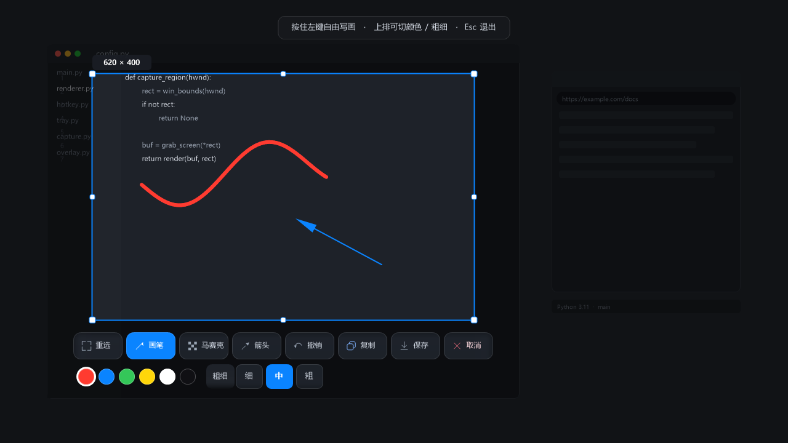
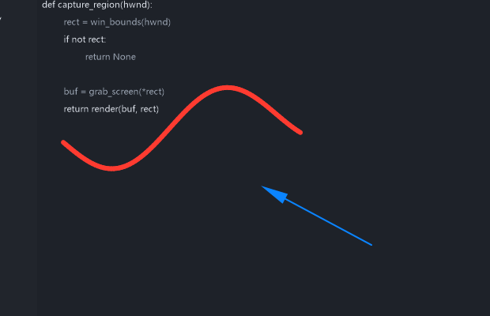

# SnapLite

轻量级 Windows 截图标注工具。**纯 Python + Win32 原生接口（GDI / GDI+）实现，零第三方依赖**——整个项目只有一个 `snap.py`，没有 numpy、没有 PyQt、没有 Pillow。


[](https://github.com/zhaozun123/Snaplite-screenshot/releases/latest)

---

## 下载

最新版本 **v1.2.0**（Windows 单文件绿色版，约 4.7 MB，双击即用，无需安装 Python）：

**[⬇ 下载 SnapLite.exe](https://github.com/zhaozun123/Snaplite-screenshot/releases/download/v1.2.0/SnapLite.exe)**

> 首次运行会在 `%APPDATA%\SnapLite\` 生成配置文件。托盘图标右键可退出（关窗口只是隐藏到托盘）。

**v1.2.0 更新**：界面改为苹果液态玻璃风（主面板 + 悬浮工具条毛玻璃）；拖动主面板时背景模糊逐像素实时刷新；
修复截图时主界面不随遮罩一起压暗、点工具后主界面消失、工具条切换画笔/马赛克/箭头时选项排残留错乱等问题。

全部版本见 [Releases](https://github.com/zhaozun123/Snaplite-screenshot/releases)。

---

## 特性

| | |
|---|---|
| **全局热键唤起** | 默认 `Ctrl + Alt + A`，可在面板或托盘菜单里改成任意组合 |
| **智能区域识别** | 自动识别鼠标下的**窗口 / 控件**边界，单击直接捕获；也可以自由拖拽框选 |
| **8 个手柄微调** | 框选后可逐边、逐角调整范围，也能整体拖动 |
| **三种标注工具** | 画笔（自由手写）、马赛克（涂抹遮挡）、箭头（指向说明） |
| **撤销 / 重做** | 多级撤销，箭头还能拖两端改方向、方向键微调 |
| **秒切输出** | 复制到剪贴板（CF_DIB）或另存为 PNG |
| **常驻托盘** | 关窗不退出，托盘菜单里可开/关开机自启 |
| **单文件绿色版** | 打包成一个 exe，扔哪都能跑，配置文件写在 `%APPDATA%\SnapLite\` |

## 界面



> 上图：全屏遮罩下框选区域，红色为画笔笔迹、蓝色为箭头，底部是浮动工具条。
> 导出成品（复制到剪贴板 / 保存 PNG 的结果）：



### 结构示意

```
┌──────────────────────────────────────────────────────┐
│  全屏半透明遮罩                                     │
│      ┌───────────────┐                               │
│      │  选区          │  ← 8 个手柄可调               │
│      │  ✎ 画笔笔迹    │                               │
│      └───────────────┘                               │
│                                                       │
│        ┌────────────────────────────────┐            │
│        │ 重选 │画笔│马赛克│箭头│撤销│复制│保存│取消 │  ← 浮动工具条
│        │  ●●●●●●  粗细 细│中│粗          │            │
│        └────────────────────────────────┘            │
└──────────────────────────────────────────────────────┘
```

## 使用

1. 运行 `SnapLite.exe`（或 `python snap.py`），程序常驻托盘
2. 按下 `Ctrl + Alt + A`（或自定义热键）唤起
3. **单击**鼠标下的窗口 / 控件 → 直接捕获；**拖拽** → 自由框选
4. 用工具条上的工具标注：
   - **画笔** — 按住左键自由手写，六种颜色 + 细/中/粗三档笔宽
   - **马赛克** — 涂抹遮挡，三档笔头 + 三档块大小
   - **箭头** — 拖动画箭头；画完可选中、拖两端改方向
5. **复制**（进剪贴板）或 **保存**（存 PNG）

### 快捷键

| 键 | 作用 |
|---|---|
| `Ctrl + Alt + A` | 唤起截图（可自定义） |
| `Esc` | 取消当前操作 / 退出工具模式 |
| `Ctrl + Z` / `Ctrl + Y` | 撤销 / 重做 |
| `方向键` | 微调选中的箭头 |
| `Delete` | 删除选中的箭头 |
| `右键` | 退出工具模式 / 删除最后一笔 |

> 在任意目录运行都可以，配置和日志统一落在 `%APPDATA%\SnapLite\`。

## 从源码运行

需要 **Windows 10/11 + Python 3.8 以上**（只用标准库，无需 `pip install` 任何东西）：

```bash
git clone https://github.com/zhaozun123/snaplite-screenshot.git
cd snaplite-screenshot
python snap.py
```

## 打包成 exe

用 [PyInstaller](https://pyinstaller.org/) 打包成单文件绿色版：

```bash
pip install pyinstaller
python -m PyInstaller SnapLite.spec --noconfirm --clean
```

产物在 `dist/SnapLite.exe`。`SnapLite.spec` 里已经排除了用不到的模块
（`ssl` / `urllib` / `tkinter` / `asyncio` …），并且不打包系统自带的 C 运行库副本
（`ucrtbase.dll` / `api-ms-win-crt-*`，Win10/11 的 System32 里都有），成品约 4.7 MB。

> 想瘦身可以再精简 `SnapLite.spec` 的 `excludes` 列表，但注意保留
> `ctypes` / `struct` / `threading` / `winreg` 相关依赖。

## 项目结构

```
snap.py              主程序（全部功能都在这一个文件里）
SnapLite.spec        PyInstaller 打包配置
make_ico.py          生成 app.ico（纯 BMP/AND 掩码，兼容各版本资源管理器）
app.ico              程序图标
assets/              README 用的界面截图（由脚本生成，勿手改）
tests/
  test_pen.py        画笔链路自测（进入模式→绘制→落笔→撤销→渲染）
  test_pen_visual.py 像素级验证：画出来的线确实是标注色
tools/
  check_undefined.py    静态检查：抓出未定义名（NameError 风险）
  audit_deadcode.py     静态检查：列出零引用的死代码
  make_screenshot.py    离屏渲染 README 界面截图
  excluded_modules.txt  打包时排除的标准库模块清单（对应 spec 里的 excludes）
.github/
  workflows/ci.yml   CI：静态检查 + 功能测试 + 打包
  ISSUE_TEMPLATE/    Bug 反馈 / 功能建议模板
```

## 开发

```bash
python tools/check_undefined.py     # 未定义名检查
python tools/audit_deadcode.py      # 死代码体检
python tests/test_pen.py            # 功能自测
python tests/test_pen_visual.py     # 像素级验证
python tools/make_screenshot.py     # 重新生成 assets/ 里的截图
```

打包：

```bash
pip install pyinstaller==6.22.3
python -m PyInstaller SnapLite.spec --noconfirm --clean
```

代码风格：中文注释，函数名 / 变量名用英文；每个 Windows API 都在模块顶部
用 `_proto()` 显式声明参数类型（ctypes 默认的 int 转换在 64 位下会截断指针）。

### 架构速览

- **App** — 所有窗口消息的处理者（主面板 / 遮罩 / 工具条三个窗口过程）
- **GFX** — GDI+ 轻量封装，绘制、裁剪、字体、颜色
- **标注数据** — `self.shapes` 是一个 dict 列表：
  - 画笔 / 马赛克：`{"t": "pen"|"mosaic", "pts": [(x,y), ...], ...}`
  - 箭头：`{"t": "arrow", "x1", "y1", "x2", "y2", "color"}`
- **坐标系** — 遮罩是全屏虚拟坐标，`self.sel` 是选区矩形，标注坐标是全屏坐标；
  渲染时通过 `ox / oy` 偏移裁剪进选区

## 已知限制

- 仅支持 Windows（大量使用 Win32 API）
- 画笔 / 马赛克的笔迹**不可单独选中**，只能整体撤销或右键删最后一笔
- 混合 DPI 多屏下，工具条按系统 DPI 缩放，跨屏时物理大小可能不一致
- 未做多语言界面（目前只有中文）

## 贡献

欢迎提 Issue 和 PR。动手前建议先跑一遍 `tools/` 里的两个静态检查，
保持零死代码、零未定义名。

## 许可证

[MIT](LICENSE) © 2026 zhaozun123
